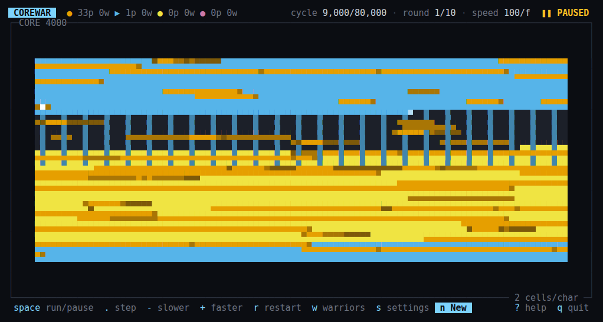
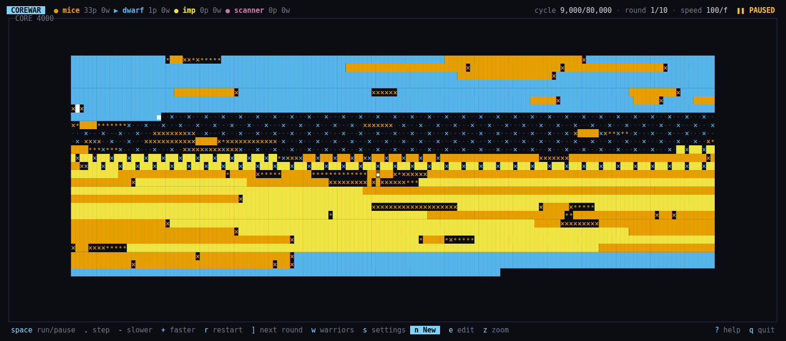
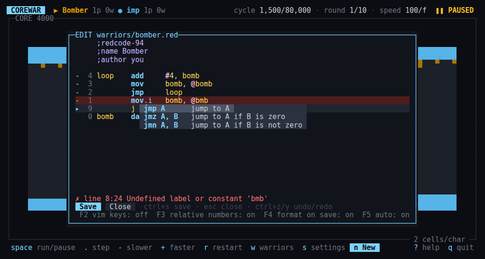

# corewar-tui

**Core War in your terminal.** Write tiny assembly programs, drop them into a shared memory ring, and watch them fight to the death.

This project is a complete implementation of the [Core War](https://corewar-docs.readthedocs.io/en/latest/) spec (ICWS'94 Redcode, with P-space). It is written in TypeScript and draws its UI with [OpenTUI](https://opentui.com). An in-app editor lets you write warriors with syntax highlighting, live diagnostics, autocomplete and format on save, then send them straight into battle.



## What is Core War?

Core War is a programming game from 1984. Each player writes a *warrior* in Redcode, a small assembly language. All warriors are loaded into one circular memory called the *core*, and they take turns running one instruction at a time. A warrior loses when all of its processes have executed a `DAT` instruction. The last warrior alive wins.

The simplest warrior is the Imp. It copies itself one cell forward, forever:

```redcode
        mov     0, 1
```

The Dwarf drops a `DAT` "bomb" on every fourth cell, and hopes to hit something:

```redcode
loop    add     #4, bomb
        mov     bomb, @bomb
        jmp     loop
bomb    dat     #0, #0
```

## Features

### The battle board
- A live view of the whole core. Each cell is coloured by the warrior that last touched it. Brightness and symbols show what happened there: executed, written, or read.
- `▶` in the header and `■` on the board mark the warrior and process that run next.
- Run, pause, single-step, and change speed from 1 to 5000 cycles per frame, or as fast as possible. The UI stays responsive at full speed.
- Click a cell, or press `Enter`, to inspect the instruction in it.
- Matches with 1 or more warriors. Solo mode makes it easy to test a change.
- Match settings with the standard presets (`standard`, `beginner`, `nano`, `tiny`, `lp`, `large`, `icws88`), or your own core size, cycle limit, process limit and more.
- A two-page help screen: the keys, then a complete Redcode reference.

On a wide terminal the whole core fits at one address per character, so you can see each `×` write and `•` read:



### The warrior editor
Press `n` for a new warrior, or `e` to edit one.


- **Syntax highlighting** for opcodes, modifiers, addressing modes, labels, numbers and comments.
- **Live diagnostics.** The parser runs while you type. Lines with errors turn red, and the status line shows the first error.
- **Autocomplete** for instructions and directives, with a one-line description of each: `jmz A, B   jump to A if B is zero`.
- **Format on save.** Labels, instructions and operands snap into aligned columns. The formatter checks that the formatted warrior compiles to exactly the same code. If it does not, your text is saved as you typed it.
- **Auto-indent and column snapping.** `Enter` lines the next instruction up under the one above. `space` (or accepting a completion with `Tab`) after a label or an instruction jumps to the next column, so code is aligned as you type.
- **Relative cell numbers** in the gutter, because Redcode addresses are relative.
- **Optional vim keys** (`F2`): motions, operators, counts, `ciw`, visual mode, `.` repeat, undo, `:w` and `:q`.
- Save is one key (`ctrl+s`). Deleted warriors go to a `.trash/` folder, so you can get them back.

### The engine
- A complete ICWS'94 parser: all opcodes and modifiers, all 8 addressing modes, `EQU`, `FOR`/`ROF`, `ORG`/`END`, expressions and P-space (`LDP`, `STP`, `PIN`).
- A fast simulator: one 80,000-cycle round takes about 3 ms.
- Matches, hills and benchmarks as a TypeScript API, with seeded random placement.
- **Checked against pMARS**, the reference implementation. 274 sources assemble identically. 361 named battles and 5,000 randomly generated warrior pairs give the same results round for round.

## Get started

You need [Bun](https://bun.sh) 1.3.14 or later.

```sh
git clone https://github.com/camerontredoux/corewar-tui.git
cd corewar-tui
bun install
bun run start
```

The first match is Dwarf against Imp. Press `space` to start, `?` for help, and `q` to quit.

### Write your first warrior
1. Press `n`. The editor opens with a commented example warrior.
2. Edit it. Errors show up as you type.
3. Press `ctrl+s` to save it to `warriors/`.
4. Press `w`, select your warrior and an opponent with `space`, and press `Enter` to fight.

After you edit a warrior, press `r` to restart the round with the new version.

## Keys

| Key | Action |
| --- | --- |
| `space` | Run or pause |
| `.` | Step one instruction |
| `+` / `-` | Faster / slower |
| `r` / `]` | Restart the round / go to the next round |
| `w` | Pick warriors and start a match |
| `n` / `e` | New warrior / edit warrior |
| `s` | Match settings |
| `z` | Zoom: fit the core on screen, or full detail |
| `Enter` | Inspect a cell |
| `?` | Help and Redcode reference |
| `q` | Quit |

The full list, including the editor keys, is in [packages/tui/README.md](packages/tui/README.md).

## Development

```sh
bun test            # about 1,600 tests
bun run typecheck
bun run oracle      # compare against pMARS (needs a ./pmars binary)
```

| Path | Contents |
| --- | --- |
| `packages/engine/` | Parser, simulator, matches and the pMARS oracle. No UI code. |
| `packages/tui/` | The OpenTUI app: board, editor, overlays. |
| `spec/` | The specs the engine and UI were built against. |
| `ARCHITECTURE.md` | Module layout and the contracts between them. |

The oracle tests use recorded pMARS output, so `bun test` does not need pMARS. `bun run oracle` regenerates the recordings, and skips if `./pmars` is not present.

## Credits

- The rules come from the [Core War documentation](https://corewar-docs.readthedocs.io/en/latest/) and the ICWS'94 draft standard.
- [pMARS](http://www.koth.org/pmars/) was the reference for the differential tests. No pMARS code is included.
- The classic warriors in `examples/` belong to their authors, who are named in each file.

## License

[MIT](LICENSE)
